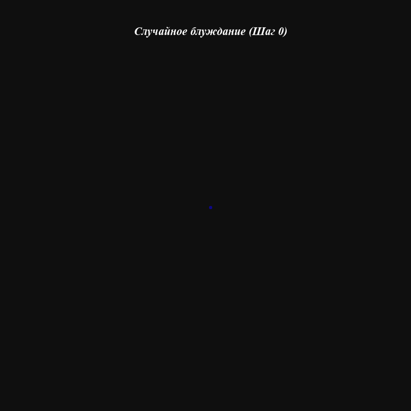
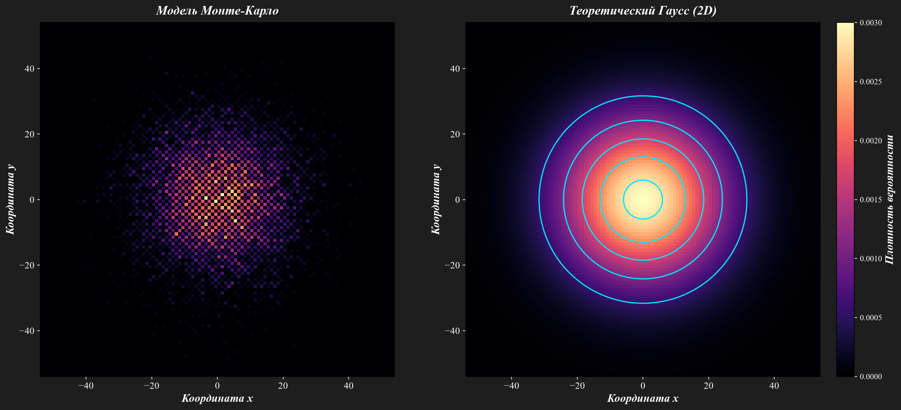
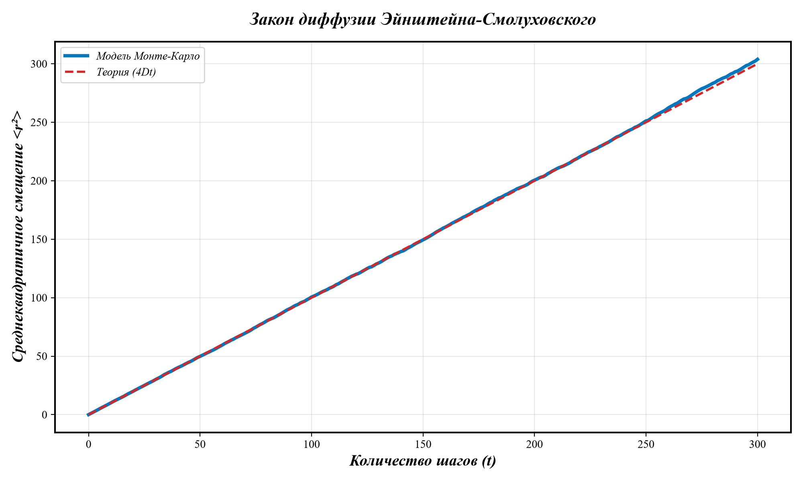

# Лабораторная работа №3: Стохастическое моделирование. Методы Монте-Карло

---

## 📑 Содержание
1. [Описание проекта](#-описание-проекта)
2. [Математическая модель](#-математическая-модель)
3. [Структура проекта](#-структура-проекта)
4. [Установка и запуск](#-установка-и-запуск)
5. [Тестирование](#-тестирование)
6. [Результаты моделирования](#-результаты-моделирования)
7. [Источники](#-источники)

---

## 📖 Описание проекта

В данной работе реализован метод Монте-Карло для моделирования броуновского движения (случайного блуждания) ансамбля частиц на двумерной решетке. 

**Цель работы** — продемонстрировать, что стохастическая модель дискретных случайных шагов при большом количестве частиц сходится к детерминированному уравнению диффузии, описываемому распределением Гаусса.



На анимации выше показан процесс эволюции облака частиц. **Светлая сплошная линия** — это теоретическая граница $2\sigma$ (две сигмы). Согласно статистике, внутри этой границы должно находиться около 86% всех частиц, что отлично видно на визуализации.

## 🧮 Математическая модель

Моделирование проводится на двумерной квадратной решетке. На каждом временном шаге $\Delta t = 1$ каждая частица независимо и с равной вероятностью (25%) смещается на 1 клетку в одном из четырех направлений (окрестность фон Неймана). 

Согласно закону Эйнштейна-Смолуховского, среднеквадратичное смещение (Mean Squared Displacement, MSD) растет линейно со временем:

$$
\langle r^2 \rangle = 4Dt
$$

где $D$ — коэффициент диффузии (для дискретной 2D-модели $D = 0.25$). 

Макроскопически распределение плотности вероятности частиц $P(x, y, t)$ описывается уравнением диффузии:

$$
\frac{\partial P}{\partial t} = D \left( \frac{\partial^2 P}{\partial x^2} + \frac{\partial^2 P}{\partial y^2} \right)
$$

Аналитическим решением этого уравнения является двумерное нормальное распределение (Гаусс), с которым мы сравниваем нашу модель:

$$
P(x,y,t) = \frac{1}{4\pi D t} \exp\left(-\frac{x^2+y^2}{4Dt}\right)
$$

## 🗂 Структура проекта

```text
LR3_MonteCarlo/
├── main.py              # Скрипт запуска, визуализация и CLI
├── model.py             # Физическая логика (Монте-Карло, MSD, теория Гаусса)
├── requirements.txt     # Зависимости проекта
├── pytest.ini           # Конфигурация для тестов
├── README.md            # Документация (этот файл)
├── results/             # Папка для графиков и GIF (создается автоматически)
└── tests/
    └── test_model.py    # Модульные тесты
```

## ⚙️ Установка и запуск

1. Клонируйте репозиторий:
   ```bash
   git clone https://github.com/ВАШ_ЛОГИН/LR3_MonteCarlo.git
   cd LR3_MonteCarlo
   ```

2. Установите зависимости:
   ```bash
   pip install -r requirements.txt
   ```

3. Запустите модель. По умолчанию моделируется 10000 частиц на 300 шагов:
   ```bash
   python main.py
   ```

### 🖥 Интерфейс командной строки (CLI)
Программа поддерживает настройку параметров через аргументы командной строки (реализовано с помощью модуля `argparse`):
*   `--N` : Количество частиц (по умолчанию 10000)
*   `--steps` : Количество временных шагов (по умолчанию 300)
*   `--out` : Папка для сохранения результатов (по умолчанию `results`)

Пример запуска с пользовательскими параметрами:
```bash
python main.py --N 5000 --steps 500 --out my_results
```

## 🧪 Тестирование

Качество кода проверяется с помощью автоматических тестов (библиотека `pytest`). Тесты проверяют:
*   Корректность размерностей генерируемых массивов.
*   Воспроизводимость результатов при фиксированном `seed`.
*   То, что в начальный момент времени все частицы находятся в начале координат.
*   Линейный рост MSD (сравнение с теоретическим значением).

Для запуска тестов используйте:
```bash
python -m pytest -v
```

## 📊 Результаты моделирования

**1. Сравнение распределения частиц с теорией**
На графике ниже показано распределение плотности вероятности координат частиц на последнем шаге. Слева — эмпирические данные, полученные методом Монте-Карло. Справа — аналитическое решение (распределение Гаусса). Голубые контурные линии на правом графике подчеркивают изолинии плотности. Совпадение картин подтверждает адекватность стохастической модели.



**2. Закон диффузии**
График зависимости среднеквадратичного смещения от времени. Синяя сплошная линия — результат работы алгоритма Монте-Карло. Красная пунктирная линия — теоретическая зависимость $4Dt$. Как видно, они практически идеально совпадают, что доказывает отсутствие систематической ошибки в реализованном генераторе случайных шагов.



---
## 📚 Источники
1. Гулд Х., Тобочник Я. Компьютерное моделирование в физике. — М.: Мир, 1990.
2. Документация библиотеки NumPy. URL: https://numpy.org/doc/stable/
3. Документация библиотеки Matplotlib. URL: https://matplotlib.org/stable/
4. Документация библиотеки Pytest. URL: https://docs.pytest.org/